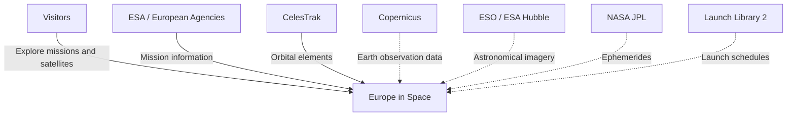
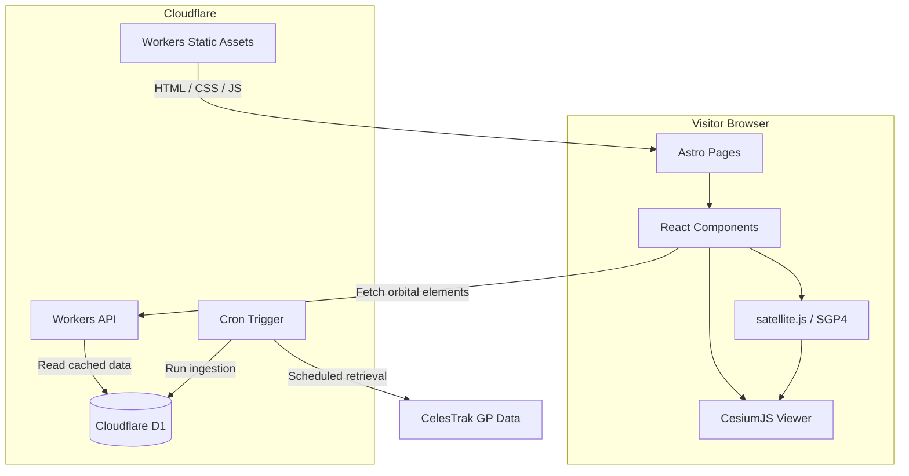
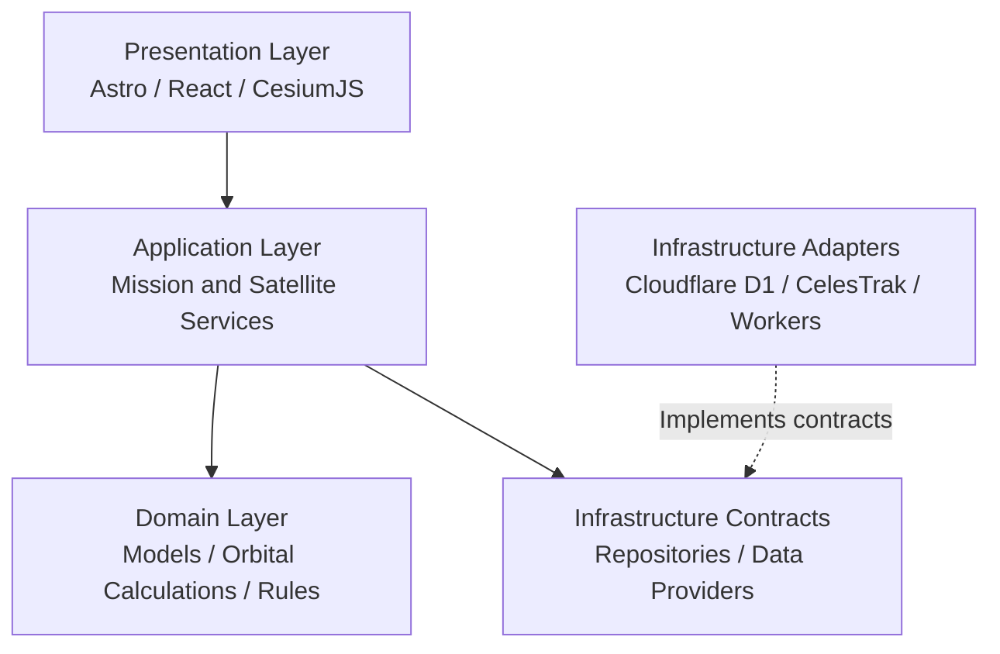
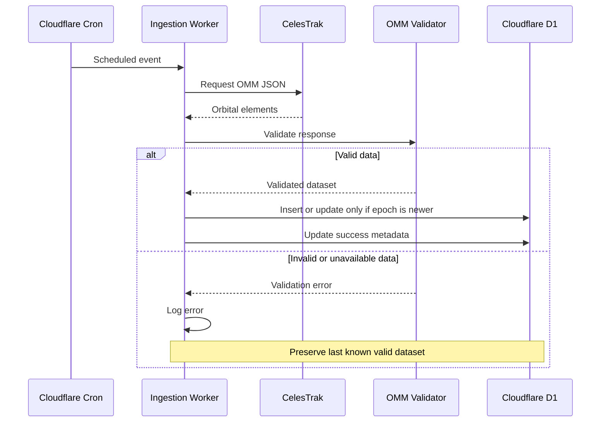
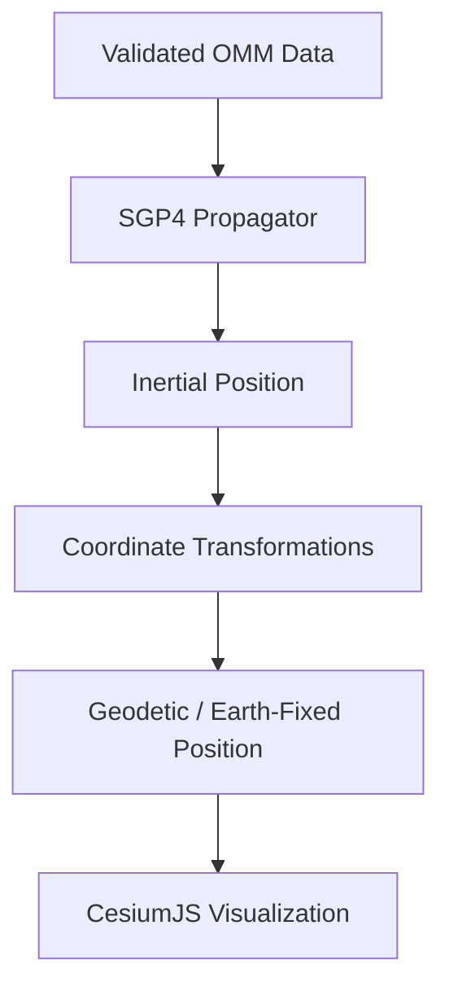
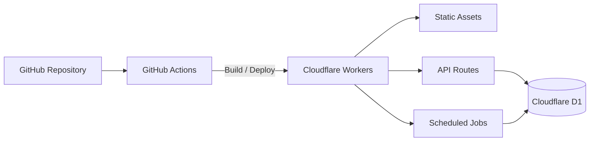

# Architecture — Europe in Space

**Status:** Proposed architecture  
**Last updated:** November 15, 2026  
**Related documents:** [Product Requirements Document](docs/Product%20Requirements%20Document.md) · [First Orbit Technical Design Document](docs/Technical%20Design%20Document.md) · [Architecture decisions](docs/decisions/README.md)\
**Initial deployment:** Cloudflare Free  
**Future deployment option:** Vercel

This document describes the system structure and its boundaries. The PRD defines product scope and acceptance, the technical design defines implementation and verification, and the individual ADRs govern recorded architecture decisions.

## 1. Overview

[Europe in Space](https://europeinspace.org) is an independent, open-source platform for exploring European space missions, satellites, observatories, and scientific discoveries through interactive visualizations and publicly available space data.

The platform is designed as a **static-first, modular web application with lightweight serverless data services**.

The architecture prioritizes:

- **Simplicity:** Minimal infrastructure and operational complexity.
- **Portability:** Application logic remains independent of the hosting provider.
- **Performance:** Static content and client-side visualization wherever practical.
- **Scientific correctness:** Validated calculations and transparent data provenance.
- **Cost efficiency:** Operation within Cloudflare's free tier for the initial release.
- **Maintainability:** Clear component boundaries and independently testable modules.
- **Openness:** Open-source software and responsible use of public scientific datasets.

The initial engineering milestone, **First Orbit**, focuses on connecting a European space mission with an interactive visualization of a real spacecraft's predicted orbit.

Later releases will expand into mission catalogs, observatories, imagery, launches, and Earth observation data.

---

## 2. Architectural Principles

### 2.1 Static-first

Pages that do not require dynamic execution should be generated during the build.

Examples include:

- Homepage.
- Mission descriptions.
- About page.
- Data source documentation.
- Observatory profiles.
- Methodology documentation.

Static content reduces infrastructure cost, improves caching, and simplifies deployment.

### 2.2 Client-side computation

Computationally intensive interactive features should execute in the browser when appropriate.

For satellite tracking, orbital calculations are performed using `satellite.js`, while CesiumJS handles 3D visualization.

The server does not calculate new satellite positions for every animation frame.

### 2.3 Infrastructure independence

Domain logic, data models, scientific calculations, and external data integrations must not depend directly on Cloudflare-specific APIs.

Cloudflare provides the initial hosting and runtime services, but it is not part of the core domain model.

A future migration to Vercel should primarily involve infrastructure adapters and deployment configuration.

### 2.4 Data provenance

Every externally sourced dataset should retain relevant metadata:

- Original provider.
- Source URL or identifier.
- Observation or orbital epoch.
- Retrieval timestamp.
- Usage rights, where relevant.
- Processing details.
- Known limitations.

Predicted positions must never be presented as direct live telemetry.

### 2.5 Progressive complexity

Infrastructure and abstractions should only be introduced when justified by actual requirements.

The initial implementation avoids:

- Microservices.
- Kubernetes.
- Distributed messaging.
- Complex orchestration.
- Mandatory relational databases.
- Unnecessary third-party SaaS dependencies.

---

## 3. System Context

Europe in Space operates between public scientific data providers and visitors using interactive web applications.



**Legend:**

- Solid connections: Initial implementation scope.
- Dashed connections: Planned future integrations.

For First Orbit, CelesTrak is the primary automated external data integration. Mission information is initially curated from official sources.

---

## 4. Technology Stack

| Layer | Technology | Responsibility |
|---|---|---|
| Web framework | Astro | Static pages, routing, content |
| Interactive UI | React | Dynamic controls and visualization UI |
| Programming language | TypeScript | Application implementation |
| Styling | Tailwind CSS | Design system and responsive styling |
| 3D visualization | CesiumJS | Earth and orbital rendering |
| Orbital propagation | satellite.js | SGP4 calculations |
| Validation | Zod | Runtime schema validation |
| Static hosting | Cloudflare Workers Static Assets | Website and frontend assets |
| API | Cloudflare Workers | Cached data endpoints |
| Data cache | Cloudflare D1 | Orbital elements and ingestion metadata |
| Scheduling | Cloudflare Cron Triggers | Periodic data refresh |
| Unit testing | Vitest | Domain and application tests |
| Browser testing | Playwright | End-to-end testing |
| CI/CD | GitHub Actions | Automated validation and deployment |
| Deployment tooling | Wrangler | Cloudflare configuration and deployment |
| Package management | pnpm | Dependencies and scripts |

All dependencies should use reproducible versions recorded in the lockfile.

### Why Astro?

Most content in Europe in Space is informational and suitable for static generation.

Astro allows the platform to combine fast, server-rendered or statically generated pages with isolated interactive React components.

Large visualization libraries can be loaded only when necessary.

### Why CesiumJS?

CesiumJS provides a geospatial 3D engine suitable for:

- Earth visualization.
- Spacecraft markers.
- Orbital paths.
- Ground tracks.
- Camera navigation.
- Time-dependent visualization.

The initial experience must not require paid Cesium ion services. Globe imagery and terrain must be configured explicitly, with appropriate licensing and attribution.

### Why Cloudflare?

Cloudflare offers a suitable starting environment for a personal project:

- Static asset hosting.
- Lightweight serverless APIs.
- Scheduled execution.
- Key-value storage.
- Custom domain support.

The application is designed to operate within the published free-tier quotas. This is a design goal, not a guarantee of unlimited free usage.

---

## 5. High-Level Architecture



The system consists of three main responsibilities:

1. **Presentation:** Deliver pages and interactive features.
2. **Data processing:** Retrieve, validate, and cache external scientific datasets.
3. **Scientific visualization:** Calculate and render positions in the visitor's browser.

### Request flow

Static pages and frontend assets are served by Cloudflare.

When visitors open the satellite tracker, the browser requests a cached orbital dataset through the API.

The browser initializes SGP4 propagation and calculates the satellite's predicted position for the requested time.

CesiumJS then renders the spacecraft and its trajectory.

Continuous animation does not require continuous backend requests.

---

## 6. Application Architecture

The application follows a lightweight layered architecture with feature-oriented organization.



### 6.1 Presentation layer

Responsible for displaying content and handling visitor interactions.

Components include:

- Astro pages and layouts.
- React interactive components.
- Mission cards and details.
- Satellite tracking controls.
- CesiumJS viewer.
- Data freshness indicators.
- Accessibility fallbacks.

Presentation components should not contain provider-specific ingestion logic.

### 6.2 Application layer

Coordinates use cases such as:

- Retrieve mission information.
- Find spacecraft associated with a mission.
- Request cached orbital elements.
- Determine data freshness.
- Prepare information for visualization.

Application services depend on domain models and infrastructure interfaces rather than concrete storage implementations.

### 6.3 Domain layer

Contains platform-independent concepts and calculations:

- Mission.
- Spacecraft.
- Orbital dataset.
- Satellite position.
- Data provenance.
- Orbital propagation.
- Coordinate transformations.

The domain layer must not import Cloudflare, Astro runtime, or CesiumJS infrastructure APIs.

### 6.4 Infrastructure layer

Implements external interactions:

- CelesTrak HTTP client.
- Cloudflare D1 repository.
- Worker request handling.
- Scheduled ingestion.
- Environment configuration.

These implementations may change when the application moves to another provider.

---

## 7. Repository Structure

The recommended initial layout is a single repository and application.

```text
europeinspace/
├── src/
│   ├── pages/
│   │   ├── index.astro
│   │   ├── about.astro
│   │   ├── data-sources.astro
│   │   ├── missions/
│   │   │   └── [slug].astro
│   │   └── satellites/
│   │       └── [id].astro
│   │
│   ├── layouts/
│   │   └── BaseLayout.astro
│   │
│   ├── components/
│   │   ├── layout/
│   │   ├── missions/
│   │   └── ui/
│   │
│   ├── features/
│   │   └── satellite-tracker/
│   │       ├── SatelliteTracker.tsx
│   │       ├── GlobeViewer.tsx
│   │       ├── SatelliteDetails.tsx
│   │       ├── TrackerToolbar.tsx
│   │       └── useSatellitePosition.ts
│   │
│   ├── core/
│   │   ├── missions/
│   │   ├── satellites/
│   │   ├── orbital/
│   │   └── models/
│   │
│   ├── integrations/
│   │   └── celestrak/
│   │
│   ├── content/
│   │   └── missions/
│   │
│   ├── styles/
│   └── config/
│
├── worker/
│   ├── index.ts
│   ├── api/
│   ├── ingestion/
│   └── storage/
│
├── public/
│   └── assets/
│
├── tests/
│   ├── unit/
│   ├── integration/
│   ├── fixtures/
│   └── e2e/
│
├── docs/
│   └── decisions/
│
├── .github/
│   └── workflows/
│
├── ARCHITECTURE.md
├── README.md
├── astro.config.mjs
├── wrangler.jsonc
├── package.json
└── pnpm-lock.yaml
```

This represents the intended structure, not necessarily the current repository contents.

Directories should be introduced incrementally. The architecture does not require every proposed module to exist before implementation begins.

A monorepo is intentionally avoided for the initial milestone.

---

## 8. Mission Content Architecture

Mission data is initially maintained through source-controlled files using Astro Content Collections.

Example:

```text
src/content/missions/
├── sentinel-2.md
├── euclid.md
└── juice.md
```

The initial milestone requires only one fully verified mission record.

### Mission model

```typescript
interface Mission {
  id: string;
  slug: string;
  name: string;
  summary: string;
  category: MissionCategory;
  status: MissionStatus;
  organizations: string[];
  spacecraftIds: string[];
  launchDate?: string;
  officialUrl: string;
  sourceIds: string[];
  lastVerifiedAt: string;
}
```

A mission may contain multiple spacecraft. Mission status and individual spacecraft status must remain separate.

### Content validation

Zod schemas should validate:

- Required fields.
- Unique identifiers.
- Valid status values.
- Date formats.
- Source URLs.
- Spacecraft relationships.

Invalid structured content should fail the build rather than silently appear on the website.

### Future evolution

If automated content updates or complex queries become necessary, the catalog can move to a database behind repository interfaces.

First Orbit keeps mission content in source-controlled files. D1 is used for orbital data.

---

## 9. Satellite Data Architecture

### 9.1 Data source

The initial orbital data source is [CelesTrak](https://celestrak.org/).

CelesTrak provides publicly accessible orbital elements in multiple formats.

Europe in Space will use **CCSDS OMM JSON** as the preferred ingestion format.

Example endpoint:

```text
https://celestrak.org/NORAD/elements/gp.php?CATNR={catalogNumber}&FORMAT=JSON
```

Catalog numbers must be verified against authoritative spacecraft metadata.

### 9.2 Data ingestion

Orbital elements are retrieved by scheduled background execution rather than independently by every visitor.



### 9.3 Initial refresh policy

Configure the schedule in the Worker deployment. Start with one refresh per day and validate that cadence against the selected spacecraft’s prediction freshness and the effect of a missed run. Adjust the schedule in deployment configuration if needed.

The frequency must respect CelesTrak's documented update cadence and usage policies.

The system should:

- Avoid unnecessary requests.
- Reject malformed responses.
- Preserve the previous valid dataset after failures.
- Preserve the newer orbital element epoch when an older valid record arrives for the same spacecraft; retrieval time must not override epoch ordering. Log skipped older updates.
- Record retrieval timestamps.
- Track orbital element epochs.
- Avoid excessive retries.

### 9.4 Persistence

Cloudflare D1 is the authoritative store for the latest validated orbital dataset per spacecraft. The spacecraft catalog identifier is the primary key. The dataset, normalized orbital epoch, retrieval timestamp, provenance and schema version are stored together.

The repository inserts a missing record or replaces an existing one only if the candidate epoch is strictly newer. D1 evaluates the condition and updates the record in a single statement. Older and equal epochs leave the published record unchanged, including its retrieval timestamp. Ingestion health is tracked separately from the dataset.

Before release, verify that an older valid update finishing after a newer one cannot replace the newer dataset. The Worker API reads directly from D1.

### 9.5 Repository interface

```typescript
interface OrbitalDatasetRepository {
  findLatest(
    noradCatalogId: number
  ): Promise<OrbitalDataset | null>;

  publishIfNewer(
    dataset: OrbitalDataset
  ): Promise<"published" | "skipped">;
}
```

The Cloudflare implementation satisfies this contract.

Future implementations could use PostgreSQL or another storage system that supports the same conditional publication contract.

### 9.6 Data freshness

The platform must distinguish:

- Orbital element epoch.
- Last successful retrieval time.
- Current simulation time.
- Stale data.
- Unavailable data.

Configure a warning threshold and a later cutoff for the selected spacecraft. Measure the time between the orbital epoch and the time being predicted. At the warning threshold, label the prediction stale and keep it visible. At the cutoff, hide the predicted position, paths, and calculated coordinates. Keep the mission information, orbital epoch, retrieval timestamp, and source visible with an explanation.

Evaluate the thresholds while the page is open and whenever simulation time changes. Validate both thresholds against the selected spacecraft before release, including a normal daily refresh cycle and a missed run.

---

## 10. Satellite Tracking and Orbital Calculations

Satellite positions are calculated in the visitor's browser using `satellite.js`.

### 10.1 Processing pipeline



### 10.2 Orbital propagation

SGP4 calculates a predicted position at a specified simulation time using the provided orbital elements.

The output must be checked for propagation errors.

The application must not treat extrapolated positions as direct spacecraft telemetry.

### 10.3 Coordinate systems

The implementation must correctly convert between the reference frames used by the propagator and renderer.

Relevant concepts include:

- TEME/inertial output from SGP4.
- Earth-fixed coordinates.
- Geodetic latitude and longitude.
- Altitude above the reference ellipsoid.
- Cesium Cartesian coordinates.

Coordinate transformations must use the correct timestamp and reference-frame conventions.

### 10.4 Units

Centralize unit conversion to prevent inconsistencies.

Examples:

- Kilometers to meters.
- Radians to degrees.
- UTC timestamps.
- Inertial to Earth-fixed coordinates.

### 10.5 Position calculation contract

```typescript
interface SatellitePosition {
  spacecraftId: string;
  timestamp: string;
  latitudeDeg: number;
  longitudeDeg: number;
  altitudeKm: number;
  positionEciKm: {
    x: number;
    y: number;
    z: number;
  };
}
```

Position calculations should be deterministic for a fixed dataset and timestamp.

### 10.6 Predicted orbital path

The predicted trajectory is generated by propagating spacecraft positions at discrete timestamps.

The implementation should:

- Sample over a configurable interval.
- Use an appropriate orbital-period estimate.
- Avoid unnecessary repeated calculations.
- Generate paths only when needed.

The orbit path should not be regenerated every animation frame. First Orbit defers the ground track, which traces the orbit onto Earth’s surface.

### 10.7 Scientific validation

Verify the numerical implementation against published SGP4 cases and independent coordinate-conversion references. Compare predictions for the selected spacecraft against Copernicus orbit products at matching instants in a common reference frame. Use the measured position error by prediction age to justify the freshness thresholds and refresh cadence. See the technical design’s scientific validation plan.

Tests should define:

- Orbital input dataset.
- Element epoch.
- Prediction timestamp.
- Coordinate frame.
- Expected position.
- Numerical tolerance.

Scientific accuracy must not depend solely on visual inspection of the globe.

---

## 11. Visualization Architecture

The satellite tracker uses React for application state and CesiumJS for scene rendering.

### 11.1 Component structure

```text
SatelliteTracker
├── TrackerToolbar
├── GlobeViewer
│   ├── EarthGlobe
│   ├── SatelliteMarker
│   ├── OrbitPath
│   └── GroundTrack
├── SatelliteDetails
├── SimulationClock
└── DataFreshnessIndicator
```

### 11.2 Responsibilities

**SatelliteTracker**

Coordinates the interactive experience, selected spacecraft, loading states, and control state.

**GlobeViewer**

Initializes CesiumJS, manages scene objects, and controls rendering lifecycle.

**Orbital calculation module**

Produces calculated spacecraft positions and paths independently of CesiumJS.

**SatelliteDetails**

Displays spacecraft metadata and calculated values in accessible HTML.

**DataFreshnessIndicator**

Displays orbital epoch, retrieval time, and relevant warnings.

### 11.3 Lazy loading

CesiumJS is relatively large and must not be included in the JavaScript bundle for unrelated pages.

The tracker should load only when the user opens the relevant experience.

### 11.4 Rendering policy

For First Orbit:

- Display one spacecraft initially.
- Update displayed positions approximately once per second.
- Avoid unnecessary React rerenders.
- Generate orbital paths separately from frame updates.
- Reduce work when the tab or viewer is hidden.
- Respect reduced-motion preferences.

### 11.5 Globe imagery

First Orbit will use a low-resolution Earth texture served from the site's static assets on a WGS84 ellipsoid. The viewer uses no provider-issued token for imagery or terrain.

Before integrating the asset, verify redistribution rights, required attribution, and mobile loading performance. Record the source and the verification results in [ADR-014](docs/decisions/014-token-free-3d-globe.md).

### 11.6 Accessibility fallback

If WebGL is unavailable, the interface must still provide:

- Spacecraft name.
- Latitude.
- Longitude.
- Altitude.
- Prediction time.
- Orbital data epoch.
- Source information.

The essential tracking data should remain understandable without the 3D rendering.

---

## 12. API Architecture

The first API serves cached orbital data from Cloudflare D1. For First Orbit, orbital data is exposed only through this API; no additional static JSON artifact is published.

### Endpoint

```http
GET /api/satellites/{noradCatalogId}/orbital-elements
```

### Response structure

```typescript
interface OrbitalApiResponse {
  spacecraftId: string;
  noradCatalogId: number;
  format: "OMM_JSON";
  epoch: string;
  fetchedAt: string;
  elements: OrbitalElements;
  source: {
    provider: "CelesTrak";
    url: string;
  };
  schemaVersion: number;
}
```

`OrbitalElements` represents a validated implementation-specific OMM schema.

### Response behavior

| Condition | HTTP status |
|---|---|
| Valid stored dataset available, including expired elements | 200 |
| Invalid identifier | 400 |
| Unknown spacecraft | 404 |
| Known spacecraft, no valid dataset available | 503 |
| Unexpected server failure | 500 |

Errors should use a consistent response contract.

### Security

The API must:

- Validate identifiers.
- Use a configured spacecraft allowlist.
- Avoid unrestricted proxy behavior.
- Return bounded payload sizes.
- Protect internal configuration.
- Avoid exposing stack traces.
- Apply appropriate HTTP caching.

Initially, the API should provide only the minimal operations required by First Orbit.

A general-purpose public developer API is outside the milestone scope.

---

## 13. Deployment Architecture

### 13.1 Initial deployment

Europe in Space will run on Cloudflare Workers Static Assets, with a Worker handling API requests and scheduled ingestion.



### 13.2 Deployment configuration

Wrangler is responsible for:

- Worker entrypoint.
- Static assets.
- D1 bindings.
- Cron configuration.
- Runtime compatibility.
- Deployment settings.

Environment-specific identifiers and credentials must not be hardcoded into domain logic.

### 13.3 Static asset routing

Ordinary page and asset requests should be handled through static asset delivery.

API routes should invoke the Worker.

The Worker should not execute unnecessarily for every static file request.

### 13.4 Scheduled execution

A Cron Trigger invokes ingestion independently of visitor traffic.

If ingestion fails, the last validated dataset remains available, subject to freshness requirements.

### 13.5 Continuous integration

GitHub Actions should validate changes before deployment.

Required checks:

- Formatting.
- Linting.
- Type checking.
- Unit tests.
- Static build.
- Relevant integration tests.

Production deployment should only occur after the required checks succeed.

### 13.6 Operational costs

**Target: €0/month infrastructure spending, excluding domain registration.**

Free-tier limits are not treated as unlimited resources.

The implementation should minimize:

- Worker invocations.
- D1 writes.
- External API requests.
- Large asset transfers.
- Backend CPU work.

Resource usage should be reviewed as the platform grows.

---

## 14. Cloud Portability

Cloudflare is the initial hosting provider, not a permanent architectural requirement.

The application must preserve a practical migration path to Vercel.

### 14.1 Portable components

The following should remain reusable:

- Astro pages.
- React components.
- Mission content.
- Domain models.
- CelesTrak connector.
- Orbital calculations.
- CesiumJS visualization.
- Validation logic.
- Application services.

### 14.2 Provider-specific components

The following may require replacement:

- Worker request handlers.
- D1 storage adapters.
- Cron configuration.
- Deployment scripts.
- Environment bindings.

### 14.3 Future Vercel migration

Potential migration sequence:

1. Deploy the Astro application to Vercel.
2. Replace Cloudflare-specific runtime handlers.
3. Migrate D1 datasets to suitable persistence.
4. Replace scheduled ingestion.
5. Verify API response compatibility.
6. Run scientific and application regression tests.
7. Validate performance and operating costs.
8. Switch DNS routing.

### 14.4 Portability principle

**Build application functionality independently. Deploy it wherever makes sense.**

The project does not need to implement Vercel support in advance.

Good module boundaries and tested contracts are sufficient preparation.

---

## 15. Reliability and Error Handling

The application must explicitly handle external data and rendering failures.

| Failure | Expected behavior |
|---|---|
| CelesTrak unavailable | Preserve valid cache and record failure |
| Malformed orbital elements | Reject new data |
| Stale orbital data | Warn at the warning threshold. Hide the prediction at the cutoff. |
| Missing spacecraft record | Show unavailable state |
| SGP4 propagation failure | Stop displaying invalid position |
| D1 unavailable | Return controlled API error |
| CesiumJS initialization failure | Display accessible fallback |
| WebGL unavailable | Display spacecraft details without globe |

The application must never silently replace missing scientific data with fabricated values.

---

## 16. Security and Privacy

### Security requirements

- Validate all external responses.
- Treat externally sourced data as untrusted.
- Restrict data APIs to supported identifiers.
- Keep deployment secrets outside Git.
- Avoid arbitrary external URL fetching.
- Apply reasonable request limits.
- Keep dependencies updated.
- Avoid rendering untrusted HTML.

### Privacy principles

First Orbit does not require user registration or personal profiles.

The application should avoid unnecessary personal data collection.

If analytics are introduced, prefer privacy-respecting, minimal collection and document the choice.

Third-party imagery and embedded services should be reviewed for privacy implications.

---

## 17. Testing Strategy

### 17.1 Unit tests

Focus on:

- Mission validation.
- Spacecraft associations.
- OMM parsing.
- Orbital propagation.
- Coordinate conversion.
- Unit conversion.
- Freshness calculations.
- Failure handling.

### 17.2 Integration tests

Validate:

- CelesTrak connector.
- Ingestion pipeline.
- D1 repository adapter.
- Worker API.
- Cache behavior.
- Failure recovery.

Normal CI tests should use recorded fixtures or controlled mocks rather than repeatedly requesting live scientific data providers.

### 17.3 End-to-end tests

Use Playwright to verify:

1. Homepage loads.
2. Visitor can open a mission page.
3. Visitor can navigate to the tracker.
4. Tracker loads a valid orbital dataset.
5. Predicted spacecraft position is displayed.
6. Timestamps and provenance are visible.
7. The page works at a mobile viewport.
8. The fallback works when visualization is unavailable.

### 17.4 Scientific correctness

Numerical validation is mandatory for orbital propagation and coordinate transformations.

Tests should compare results against independently established reference values within documented tolerances.

A visually plausible orbit is not sufficient proof of correctness.

---

## 18. Performance Strategy

### Static website

- Generate content during build.
- Minimize global JavaScript.
- Use compressed assets.
- Optimize images.
- Cache static resources appropriately.
- Avoid blocking rendering on external data services.

### Satellite tracker

- Load CesiumJS on demand.
- Display a limited number of spacecraft.
- Avoid generating orbital paths on every frame.
- Minimize React state updates.
- Stop or reduce computation when not visible.
- Use conservative rendering settings on mobile devices.

Performance must be measured on a representative physical phone under the documented network profile. The technical design defines launch checks for tracker readiness, HTML fallback, and free-tier usage.

---

## 19. Observability and Operations

Even as a pet project, Europe in Space should provide enough observability to detect failures.

### Initial signals

- Deployment status.
- Ingestion success or failure.
- Last successful orbital-data refresh.
- API errors.
- Orbital dataset freshness.
- Unhandled browser errors during development.

### Operational principles

- Prefer structured, concise logs.
- Avoid logging personal data.
- Monitor free-tier utilization.
- Keep failure modes understandable.
- Avoid adding paid monitoring infrastructure without a demonstrated need.

More advanced observability can be introduced as usage grows.

---

## 20. Data Licensing and Attribution

Europe in Space uses publicly accessible scientific information but does not assume that all content is freely redistributable.

For each integration, the project should verify:

- Data licensing.
- Redistribution permissions.
- API terms.
- Attribution requirements.
- Image usage rights.
- Update and caching restrictions.

The project source code license does not automatically apply to third-party imagery or datasets.

### Independent project disclaimer

Europe in Space is an independent, open-source project and is not affiliated with or endorsed by ESA, EUMETSAT, ESO, the European Union, OpenAI, or other organizations.

Satellite positions are calculated predictions based on publicly available orbital elements and must not be used for operational or safety-critical purposes.

---

## 21. AI-Assisted Development

Development of Europe in Space is assisted by [OpenAI Codex](https://developers.openai.com/codex/).

Codex may be used for:

- Exploring implementation approaches.
- Implementing features.
- Refactoring code.
- Generating test cases.
- Debugging.
- Reviewing changes.
- Producing technical documentation.

AI-assisted development does not replace engineering accountability.

The project maintainer remains responsible for:

- Architectural decisions.
- Scientific correctness.
- Security.
- Licensing.
- Testing.
- Reviewing and accepting changes.

Selected workflows and lessons may be documented publicly to share practical experience with AI-assisted software engineering.

Use of Codex does not imply affiliation with or endorsement by OpenAI.

---

## 22. Architecture Decision Records

See the [ADR index](docs/decisions/README.md) for the authoritative decision records and statuses. Acceptance records maintainer approval. The release checks in the technical design verify the implementation.

---

## 23. Evolution Roadmap

The architecture will evolve through incremental product milestones.

### First Orbit

Initial implementation:

- Website foundation.
- One verified mission.
- One trackable spacecraft.
- CelesTrak ingestion.
- Cloudflare D1 orbital storage.
- Browser-side SGP4.
- CesiumJS visualization.
- Cloudflare deployment.

### Mission Explorer

Expand the curated mission catalog, search, filters, and spacecraft relationships.

### Imagery and Observatories

Introduce licensed imagery, observatory records, and related scientific information.

### Launches and Earth Observation

Add launch schedules, selected Copernicus imagery, and richer geospatial experiences.

### Advanced Exploration

Potential additions:

- Deep-space ephemerides.
- Satellite pass predictions.
- Interactive mission timelines.
- Solar system visualization.
- Public APIs.
- AI-assisted exploration interfaces.

Later milestones may require new data models and persistence capabilities, but they should preserve the existing architecture principles.

---

## 24. Known Trade-offs

### Cloudflare D1

**Benefit:** The epoch check and publication are one database operation.

**Trade-off:** The database requires a schema migration and is subject to plan quotas and service availability.

**Mitigation:** Keep the schema small, read by primary key, and confine D1 bindings to the repository adapter.

### Client-side orbital propagation

**Benefit:** Interactive updates without continuous backend computation.

**Trade-off:** Browser resource usage and client-side implementation complexity.

**Mitigation:** Limited spacecraft, lazy loading, tested calculations, and fallback views.

### Astro static generation

**Benefit:** Fast pages, low runtime costs, and straightforward deployment.

**Trade-off:** Dynamic catalog updates require rebuilds or client-side data loading.

**Mitigation:** Keep editorial content relatively static and use APIs for frequently changing data.

### Single deployment

**Benefit:** Simple operations and maintenance.

**Trade-off:** Less independent scaling of components.

**Mitigation:** Maintain logical module boundaries and introduce separate services only if justified.

### Cloudflare Free

**Benefit:** Minimal operating cost.

**Trade-off:** Quotas, runtime restrictions, and provider constraints.

**Mitigation:** Cache aggressively, minimize backend processing, monitor usage, and preserve portability.

---

## 25. Open Architectural Questions

The following decisions remain open until implementation provides enough evidence:

1. Which of Sentinel-2A, Sentinel-2B, and Sentinel-2C passes the spacecraft comparison in the technical design?
2. What validated warning and cutoff ages should First Orbit use for the selected spacecraft?
3. Which locally hosted Earth texture meets the redistribution, attribution, and mobile performance checks?
4. What browser performance thresholds should determine simplified rendering?
5. At what point should editorial content move beyond source-controlled files?
6. What level of observability can be achieved entirely within free-tier limits?
7. How should future European mission classification be standardized?

Open questions should be resolved through small technical experiments and documented decisions, rather than premature infrastructure changes.

---

## 26. Reference Documentation

### Application

- [Astro](https://docs.astro.build/)
- [React](https://react.dev/)
- [TypeScript](https://www.typescriptlang.org/)
- [Tailwind CSS](https://tailwindcss.com/)

### Orbital Data and Visualization

- [CelesTrak GP Data Formats](https://celestrak.org/NORAD/documentation/gp-data-formats.php)
- [satellite.js](https://github.com/shashwatak/satellite-js)
- [CesiumJS](https://cesium.com/learn/cesiumjs-learn/)

### Cloudflare

- [Cloudflare Workers](https://developers.cloudflare.com/workers/)
- [Workers Static Assets](https://developers.cloudflare.com/workers/static-assets/)
- [Cloudflare D1](https://developers.cloudflare.com/d1/)
- [Cron Triggers](https://developers.cloudflare.com/workers/configuration/cron-triggers/)
- [Wrangler](https://developers.cloudflare.com/workers/wrangler/)

### Testing and Deployment

- [Vitest](https://vitest.dev/)
- [Playwright](https://playwright.dev/)
- [GitHub Actions](https://docs.github.com/en/actions)
- [Vercel](https://vercel.com/docs)

---

## 27. Summary

Europe in Space is designed as a **static-first, modular and portable application powered by real scientific data**.

The initial implementation combines:

- Astro for content and routing.
- React for interactive interfaces.
- CesiumJS for 3D visualization.
- satellite.js for orbital calculations.
- Cloudflare Workers for lightweight APIs.
- Cloudflare D1 for cached orbital elements.
- Cron Triggers for scheduled ingestion.
- GitHub Actions for automated validation and deployment.

The architecture deliberately minimizes operational complexity while preserving room for scientific and technical experimentation.

**First Orbit is the initial proof that these components can work together to make European space exploration interactive, accessible, and enjoyable.**

The guiding architectural principle is:

**Build the simplest reliable system that supports exploration today without limiting what the project can become tomorrow.**
